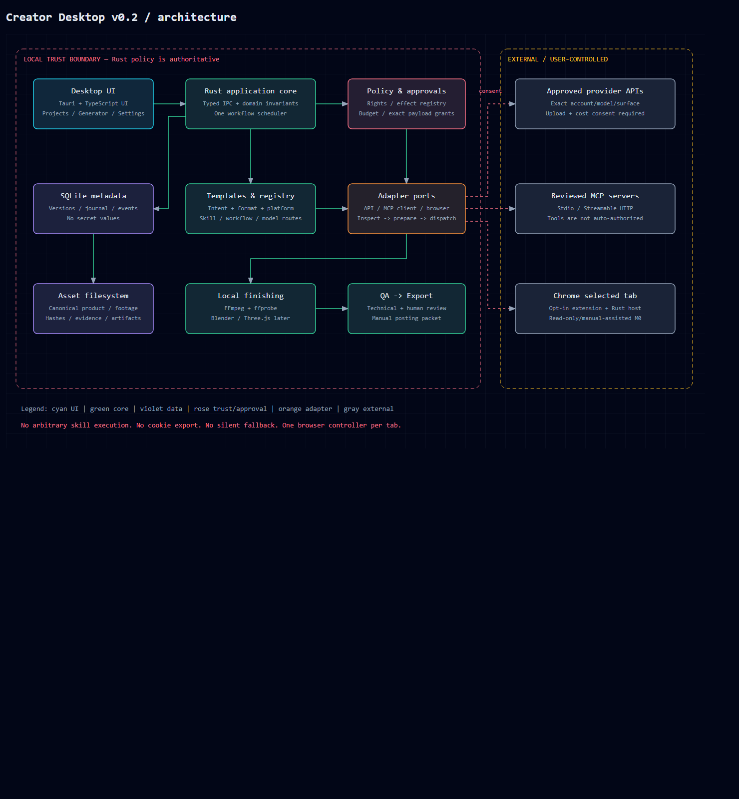
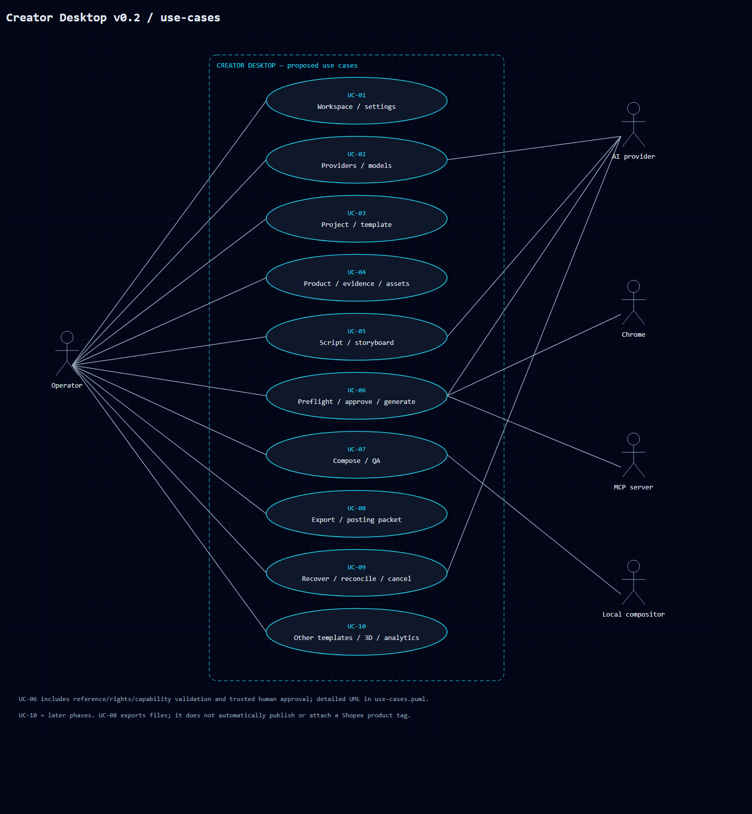
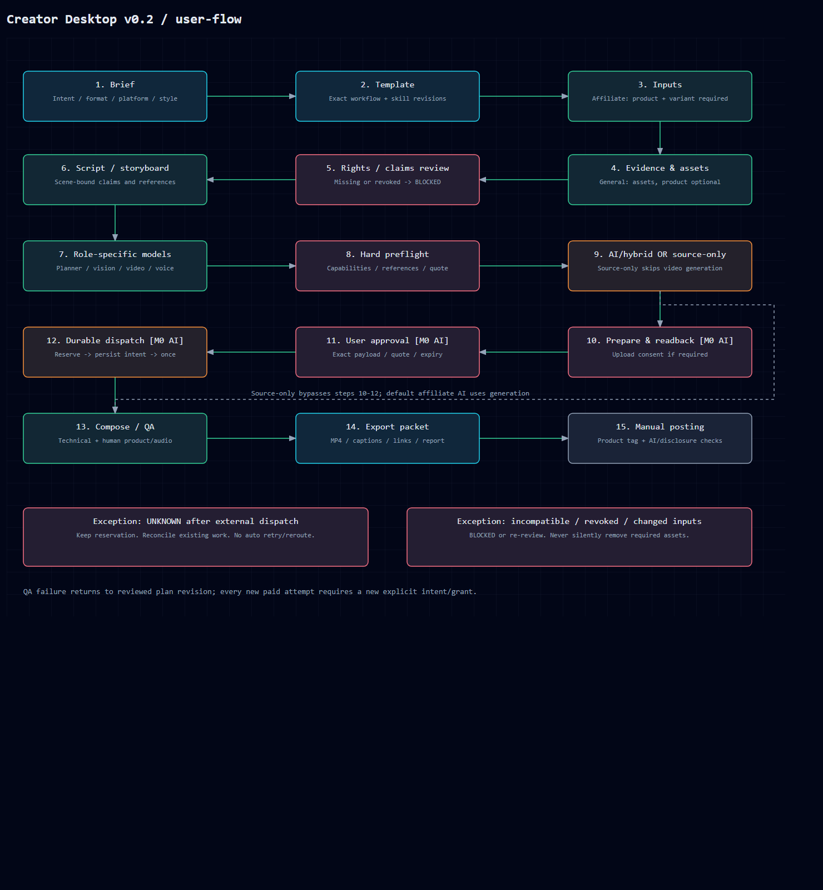
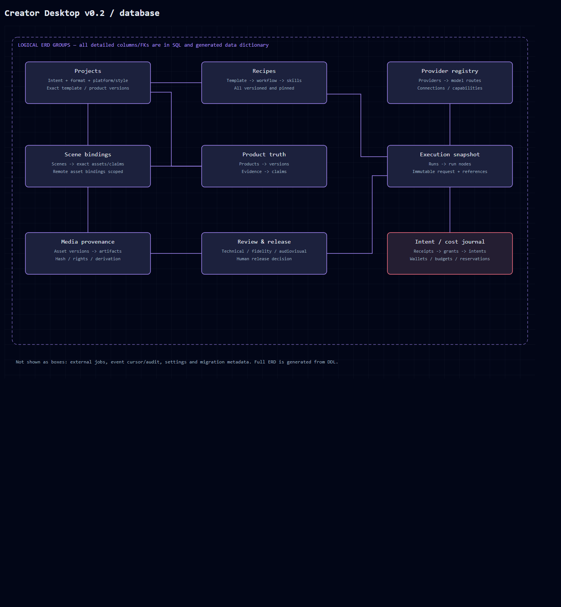

# Creator Desktop — rencana aplikasi v0.2

Paket PRD/desain untuk aplikasi desktop Rust yang mengoordinasikan produk, aset, template/workflow, provider/model AI, MCP, Chrome, komposisi video, QA dan export. Fokus MVP: affiliate Shopee Indonesia AI-assisted/hybrid berbasis produk/varian dan media berizin, dengan satu exact generative video route yang perlu diuji. Lane engineering 3D memakai Blender/Three.js sebagai ekspansi terpisah, bukan default affiliate.

Status: rencana untuk direview, bukan aplikasi yang sudah dibangun. Tidak ada instalasi, login, upload, generation, pemakaian kredit atau publishing yang dilakukan oleh paket ini.

## Keputusan arah produksi terbaru

[Addendum v0.2 — Affiliate AI/hybrid; engineering 3D memakai Blender/Three.js](08-PRODUCTION-LANES.txt) memperbarui prioritas editorial v0.1. Lebih diterima audiens masih hipotesis yang perlu dibuktikan, bukan hasil pengujian. Aplikasi dan koneksi generation belum diimplementasikan.

## Baca rencana

- [Overview dan keputusan terbuka](00-README.txt)
- [PRD, objectives dan core features](01-PRD.txt)
- [Use cases, user flows dan state machines](02-FLOWS-AND-USE-CASES.txt)
- [Arsitektur, tech stack, ADR dan NFR](03-ARCHITECTURE.txt)
- [Database design dan invariants](04-DATABASE.txt)
- [Kontrak provider/model, adapter, MCP, Chrome dan workflow](05-INTEGRATION-CONTRACTS.txt)
- [Roadmap, acceptance, QA dan risk register](06-DELIVERY-AND-QA.txt)
- [Catatan sumber primer dan batas bukti](07-SOURCE-NOTES.txt)
- [Requirements matrix](requirements.csv)
- [SQLite DDL usulan](schema/001-initial.sql) dan [data dictionary](schema/data-dictionary.csv)

Untuk membaca offline, unduh/clone repository lalu buka index.html atau diagrams.html di folder ini. GitHub menampilkan source HTML, bukan menjalankannya sebagai aplikasi. HTML ini tidak memerlukan server, JavaScript atau network-loaded fonts.

## Diagram

Sumber diagram dapat diedit di [diagrams/](diagrams/). Screenshot di bawah dihasilkan dari SVG rencana melalui headless browser; bukan screenshot UI aplikasi yang sudah dibangun.

### Arsitektur

### Use case

### User flow

### Logical database groups

Full ERD dengan kolom dan FK tersedia di [database-full.mmd](diagrams/database-full.mmd); screenshot kelompok tidak menggantikan DDL.

## Pemeriksaan yang dapat dijalankan

Dari folder ini, gunakan Python dengan SQLite yang mendukung STRICT tables dan JSON:

    python schema/verify_schema.py
    python verification/verify_plan.py

Regresi negatif untuk -O/-OO/PYTHONOPTIMIZE tersedia pada verification/test_verify_plan.py. Set CREATOR_PLAN_SCRATCH ke direktori scratch yang boleh dipakai, lalu jalankan `python -B verification/test_verify_plan.py`. Validator utama sengaja menolak optimized mode agar pemeriksaannya tidak hilang.

Pemeriksa memakai data synthetic dan SQLite disposable; tidak menghubungi provider atau menjalankan generation. Direktori scratch dapat dipilih melalui CREATOR_PLAN_SCRATCH atau TMPDIR; fallback berada di cache pengguna, bukan media workspace.

[Hasil pemeriksaan plan](verification/plan-validation.json) dan [batas status](verification/FINAL-STATUS.json) memisahkan pemeriksaan schema/dokumen dari acceptance aplikasi. Rust/Tauri build, live Chrome/MCP, provider dispatch, produksi video, full workspace restore dan revenue validation belum dijalankan.

## Batas publikasi

Yang diterbitkan: dokumen authored, diagram, DDL, test/validator, source URL ledgers dan evidence pemeriksaan rencana. Raw HTML/page captures, kredensial, browser session/cookies, profil agent dan data akun tidak disertakan. Status ini bukan lisensi untuk menyalin media produk pihak ketiga; hak aset tetap harus ditinjau per proyek.

Tidak ada app source scaffold atau executable production. Publikasi paket ini tidak berarti branch sudah di-merge ke main atau aplikasi siap dipakai.
